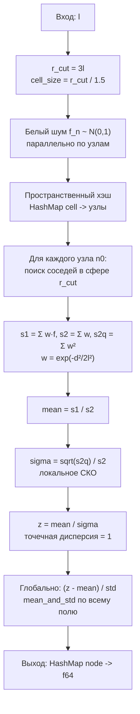

# Узловое коррелированное случайное поле: математика и алгоритм

Документ описывает текущую реализацию
[`LsModel::generate_nodal_correlated_random_field`](../src/lsmodel.rs).

## Сигнатура

```rust
pub fn generate_nodal_correlated_random_field(&self, l: f64) -> HashMap<usize, f64>
```

- `l` — масштаб гауссова ядра; длина корреляции поля `Lc = 2l`.
- Возвращает словарь `номер узла → значение поля`, нормированный к среднему `0`
  и стандартному отклонению `1`.

## Вход

Модель (`LsModel`) содержит `nodes: BTreeMap<usize, LsNode>`, где `LsNode` имеет
поля `n`, `x`, `y`, `z`. Порядок ключей детерминирован, что важно для
воспроизводимости.

## Этап 1. Производные параметры

```rust
let r_cut = 3.0 * l;          // радиус отсечения окрестности
let cell_size = r_cut / 1.5;  // размер ячейки пространственного хэша
```

Обоснование:

- гауссово ядро `exp(-d² / 2l²)` за радиусом `3l` имеет вес
  `exp(-4.5) ≈ 0.011`, то есть вклад отбрасываемых узлов пренебрежим;
- `cell_size = r_cut / 1.5` означает, что радиус окрестности покрывает
  `ceil(3l / 2l) = 2` ячейки в каждую сторону (см. `node_neibors`), что даёт
  окно `5 × 5 × 5 = 125` ячеек при плотности узлов порядка одного на ячейку.

## Этап 2. Белый шум

```rust
let f: HashMap<usize, f64> = self
    .nodes
    .par_iter()
    .map_init(
        || rand::rng(),
        |local_rng, (&n, _)| (n, StandardNormal.sample(local_rng)),
    )
    .collect();
```

Каждому узлу независимо назначается стандартная нормальная величина:

$$
f_n \sim \mathcal{N}(0, 1), \qquad f_n \perp f_m \text{ при } n \ne m
$$

Используется `rand_distr::StandardNormal`, то есть распределение
`N(0, 1)`, а не равномерное `U(0, 1)`. Это существенно:

- среднее белого шума `μ_f = 0`, поэтому фильтр не даёт систематического
  сдвига даже при отсечении ядра на границе;
- дисперсия `σ_f² = 1`, что делает нижеследующие формулы нормировки
  безразмерными;
- распределение поля после свёртки остаётся нормальным при любом числе
  усредняемых соседей, включая граничные узлы с малым числом соседей.

**Недетерминированность.** `map_init` создаёт отдельный экземпляр глобального
ГПСЧ (`rand::rng()`, то есть `ThreadRng`) на каждый рабочий поток rayon.
Поэтому:

- поле не воспроизводится между запусками;
- поле не воспроизводится между конфигурациями числа потоков.

Для воспроизводимости нужен детерминированный ГПСЧ на узел, например
`SmallRng::seed_from_u64(mix(seed, n))` или `ChaCha8Rng::seed_from_u64(...)`.
Эта схема в текущей реализации не используется.

## Этап 3. Пространственный хэш

```rust
let sh = self.nodes_spacial_hash(cell_size);
```

Узлы раскладываются по регулярной решётке с шагом `cell_size`:

$$
\text{cell}(x, y, z) = \left(\lfloor x / h \rfloor, \lfloor y / h \rfloor, \lfloor z / h \rfloor\right),
\qquad h = \text{cell\_size}
$$

Хэш — это `HashMap<(isize, isize, isize), Vec<usize>>`, построенный за один
линейный проход по узлам. Назначение — снизить стоимость поиска соседей с
`O(N)` до `O(1)` в среднем:

```rust
pub fn node_neibors(
    &self,
    n0: &LsNode,
    spacial_hash: &SpacialHash,
    cell_size: f64,
    radius: f64,
) -> Vec<usize>
```

Алгоритм поиска соседей:

1. `n_cells = ceil(radius / cell_size)` — число ячеек в каждую сторону;
2. перебираются все ячейки куба `(2·n_cells + 1)³` вокруг ячейки узла;
3. из каждой существующей ячейки берутся узлы с
   `‖x - x₀‖² ≤ radius²` (сравнение квадратов расстояний, без `sqrt`);
4. результат — `Vec` номеров узлов, **включая сам узел**.

Внутри `node_neibors` для каждой ячейки вызывается `par_iter` — вложенный
параллелизм, вложенный внутрь внешнего параллельного обхода. Это работает,
но добавляет накладные расходы планировщику; внешний параллелизм по узлам
уже обеспечивает загрузку ядер.

## Этап 4. Свёртка с гауссовым ядром и локальная нормировка

Основной шаг, выполняемый параллельно по всем узлам:

```rust
self.nodes
    .par_iter()
    .progress_with(bar.clone())
    .map(|(_, n0)| {
        let nds = self.node_neibors(n0, &sh, cell_size, r_cut);
        let (s1, s2, s2q) =
            nds.iter()
                .fold((0.0f64, 0.0f64, 0.0f64), |(a1, a2, a3), &m| {
                    let w =
                        (-n0.distance_squared_to_node(&self.nodes[&m]) / 2.0 / l / l).exp();
                    (a1 + w * f[&m], a2 + w, a3 + w * w)
                });
        let mean = s1 / s2;
        let sigma = (s2q / (s2 * s2)).sqrt();
        (n0.n, mean / sigma)
    })
```

### 4.1. Веса

Для узла `n₀` и каждого соседа `m` из окрестности `r_cut`:

$$
w_m = \exp\left(-\frac{d_m^2}{2 l^2}\right),
\qquad d_m^2 = \|x_m - x_{n_0}\|^2
$$

Это нормированное гауссово ядро с параметром масштаба `l` (стандартное
отклонение ядра `l`). Все три накопителя ниже используют **одно и то же**
`w_m` — это необходимое условие корректности нормировки.

### 4.2. Накопители

Параллельно (в одном `fold`) вычисляются:

$$
s_1 = \sum_m w_m f_m,
\qquad
s_2 = \sum_m w_m,
\qquad
s_{2q} = \sum_m w_m^2
$$

Плюсы такой схемы: один проход по соседям, `exp` вычисляется один раз на
соседа, три скаляра вместо трёх отдельных проходов.

### 4.3. Сглаженное значение

$$
\bar{z}_{n_0} = \frac{s_1}{s_2} = \frac{\sum_m w_m f_m}{\sum_m w_m}
$$

Это **нормированное взвешенное среднее** — стандартный ядерный сглаживатель
(ядро Надарая—Ватсона / "one-sided kernel regression" на границе).

### 4.4. Дисперсия фильтра

Поскольку `f_m` независимы и одинаково распределены с `Var[f] = 1`:

$$
\mathrm{Var}[\bar{z}] = \sum_m \left(\frac{w_m}{s_2}\right)^2 \mathrm{Var}[f_m]
= \frac{\sum_m w_m^2}{s_2^2} = \frac{s_{2q}}{s_2^2}
$$

а `E[z̄] = 0`, так как `E[f] = 0`.

Величина

$$
\sigma_{n_0} = \sqrt{\frac{s_{2q}}{s_2^2}} = \frac{\sqrt{\sum_m w_m^2}}{\sum_m w_m}
$$

— это **локальное стандартное отклонение** фильтра в единицах `σ_f`.

### 4.5. Локальная нормировка

$$
z_{n_0} = \frac{\bar{z}_{n_0}}{\sigma_{n_0}}
= \frac{s_1 / s_2}{\sqrt{s_{2q}} / s_2} = \frac{s_1}{\sqrt{s_{2q}}}
$$

Итоговое значение делится на **локальное** СКО, а не на глобальное. Это
ключевой момент.

### 4.6. Зачем нужна локальная нормировка

Для бесконечного однородного домена `σ` одинакова во всех узлах и равна
`σ_f / sqrt(N_eff)`, где

$$
N_{eff} = \frac{(\sum w)^2}{\sum w^2}
$$

— эффективное число усредняемых узлов.

На **границе** ядро видит только часть окрестности:

| Положение | Доступная доля сферы | `N_eff` | `σ` относительно центра |
|---|---|---|---|
| Внутренний узел | 1 | `N` | 1 |
| Грань | ~1/2 | ~`N/2` | ~1.4 |
| Ребро | ~1/4 | ~`N/4` | ~2 |
| Угол | ~1/8 | ~`N/8` | ~2.8 |

Без локальной нормировки граничные узлы получают дисперсию в 2–8 раз
больше внутренних. Именно это приводит к характерному артефакту:
**экстремумы поля (минимумы и максимумы) всегда расположены на границе и
особенно в углах**.

Деление на `σ_{n₀}` устраняет эту зависимость: после него **точечная
дисперсия поля одинакова во всех узлах**, включая ребро и угол.

### 4.7. Свойства нового поля

- `E[z_n] = 0` для всех узлов;
- `Var[z_n] = 1` для всех узлов;
- пространственная корреляционная функция определяется ядром и **не
  меняется** от поточечного деления на скаляр;
- корреляция соседних узлов ненулевая, поэтому выборочная дисперсия всего
  поля может отличаться от 1 на величину порядка эффекта кластеризации.

## Этап 5. Глобальная стандартизация

```rust
let zs = z.values().copied().collect::<Vec<f64>>();
let (mean, std) = mean_and_std(&zs);
let z = z.par_iter().map(|(n, zz)| (*n, (zz - mean) / std)).collect();
```

`mean_and_std` (см. `utils.rs`) считает:

$$
\bar{x} = \frac{1}{N}\sum_i x_i, \qquad
s = \sqrt{\frac{1}{N-1}\sum_i (x_i - \bar{x})^2}
$$

Это двухпроходный алгоритм (сначала среднее, затем разброс), устойчивый к
катастрофическому сокращению — в отличие от одноформульного
`(Σx² - (Σx)²/N)/(N-1)`.

Финальная нормировка `(z - mean) / std`:

- убирает остаточный сдвиг и приводит глобальное СКО ровно к 1;
- **не** возвращает граничные узлы к искажённой дисперсии, потому что перед
  этим уже применена локальная нормировка (раздел 4.5);
- при наличии локальной нормировки изменяет значения на доли процента.

Порядок шагов принципиален: сначала локальная нормировка, затем глобальная.
Обратный порядок (только глобальная) даёт граничный артефакт.

### Численный нюанс: недетерминизм суммы

`mean_and_std` использует `rayon::sum()`, который разбивает диапазон на
части и складывает их в порядке планировщика. Порядок сложения чисел с
плавающей точкой влияет на последние биты результата, поэтому значение `std`
(и, следовательно, итоговое поле) может отличаться в младших разрядах между
запусками. Для бит-в-бит воспроизводимого результата суммирование нужно
делать в фиксированном порядке, например последовательно обходя
`BTreeMap`-ключи.

## Этап 6. Вывод прогресса

`indicatif::ProgressBar` с шаблоном
`{prefix} [{bar:40}] {pos}/{len} {percent}% ETA {eta}` и
`ParallelProgressIterator::progress_with(bar.clone())`.

Накладные расходы:

- `bar.inc(1)` на каждый элемент — одна атомарная операция `fetch_add`;
- отдельный поток-художник, перерисовывающий экран несколько раз в секунду
  (на Windows каждая перерисовка — вызов `WriteFile` для консольного хэндла).

При стоимости обработки одного узла порядка микросекунды (поиск соседей +
`exp`) это пренебрежимо. Для дешёвых поузловых операций бар может стоить
несколько процентов; тогда его отключают через
`ProgressDrawTarget::hidden()` при неинтерактивном выводе.

## Полная схема алгоритма



## Сложность

Обозначим:

- `N` — число узлов;
- `ρ` — средняя плотность узлов (узлов на единицу объёма);
- `h = cell_size` — шаг хэша.

Окрестность радиуса `r_cut = 3l` содержит в среднем

$$
n_{bar} \approx \frac{4}{3}\pi (3l)^3 \rho
$$

узлов (а на границе — меньше).

| Этап | Сложность |
|---|---|
| Генерация белого шума | `O(N)` |
| Построение хэша | `O(N)` |
| Поиск соседей (все узлы) | `O(N · n_bar)` в среднем |
| Свёртка | `O(N · n_bar)` |
| Глобальная статистика | `O(N)` |
| Память | `O(N)` |

Практическое правило: `n_bar` должно лежать в диапазоне сотен — чтобы
граничный эффект был мал (сфера `3l` должна содержать достаточно узлов) и
чтобы не тратить время впустую. При `3l ≈ 2–3` размера элемента это
выполняется.

## Известные ограничения и точки роста

### Граничное смещение (bias)

Нормировка выравнивает **дисперсию**, но не **смещение**. Ядерная регрессия
на границе имеет смещение порядка `O(h²)` (где `h` — шаг сетки): значения в
приграничном слое систематически отличаются от того, что дала бы бесконечно
гладкая экстраполяция. Практические варианты:

1. увеличить `r_cut` (до `4–5l`) — смещение падает, стоимость растёт как
   куб радиуса;
2. локальная линейная регрессия вместо взвешенного среднего — убирает
   `O(h²)`;
3. генерация шума в «гало»-слое вне домена и фильтрация с учётом
   виртуальных соседей — единственный способ получить статистически
   однородное поле во всём домене, включая границу.

### Постобработка для ячеичных полей

Если поле затем осредняется в элементы
([`nodal_field_to_cell_field`](../src/lsmodel.rs)), дисперсия падает из-за
сглаживания. Это ожидаемый эффект, а не ошибка; перенормировать заново
нужно только если модель требует заданного межэлементного разброса, и такая
нормировка должна быть явной (через
[`standardize_field`](../src/lsmodel/utils.rs)), а не скрытой внутри
конвертера.

### Воспроизводимость

- Нет seed → нет воспроизводимости (раздел 2).
- `mean_and_std` через параллельную сумму даёт различия в младших битах.

### Вложенный параллелизм

`node_neibors` параллелит обход узлов внутри ячейки, хотя внешний цикл уже
параллелен. На больших моделях это даёт лишние накладные расходы; замена
внутреннего `par_iter` на последовательный `for` обычно ускоряет расчёт и
улучшает кэш-локальность.

## Сопутствующие функции

| Функция | Назначение |
|---|---|
| `LsModel::nodes_spacial_hash` | построение хэша `cell → [узлы]` |
| `LsModel::node_neibors` | узлы в сфере заданного радиуса |
| `utils::mean_and_std` | среднее и выборочное СКО (двухпроходный) |
| `utils::standardize_field` | явная стандартизация поля к `mean=0, std=1` |
| `utils::norm_distribution_to_mean_std` | аффинный перенос `x ↦ mean + std·x` |
| `LsModel::nodal_field_to_cell_field` | осреднение узлового поля в элементы |

## Параметры: сводка

| Параметр | Значение в коде | Влияние |
|---|---|---|
| `l` | аргумент | масштаб ядра; `Lc = 2l` |
| `r_cut` | `3l` | радиус отсечения; ↑ → меньше bias, дороже |
| `cell_size` | `r_cut / 1.5` | шаг хэша; влияет на число просматриваемых ячеек |
| `n_cells` | `ceil(r_cut / cell_size) = 2` | окно `5×5×5` ячеек |
| `N(0,1)` | `StandardNormal` | центрированный белый шум |
